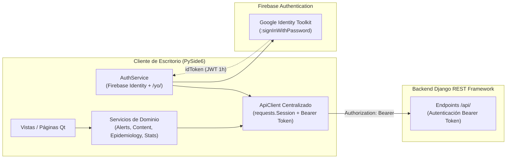

# HACKAJAL — Guía de Integración Backend (Django + Firebase)

Este documento describe la arquitectura de comunicación entre la aplicación de escritorio HACKAJAL (PySide6) y los servicios de backend (Django REST Framework y Firebase Authentication), especificando los contratos existentes, el flujo de autenticación, el manejo de errores y las directrices para el responsable de backend.

---

## 1. Arquitectura de Comunicación

La comunicación sigue un modelo desacoplado y centralizado:



### Principios Fundamentales:
1. **Cliente HTTP Centralizado (`ApiClient`):** Ninguna pantalla o widget realiza llamadas HTTP directas. Todas las peticiones pasan por `ApiClient`, el cual gestiona la URL base, timeouts, encabezados, serialización JSON y control de sesiones expiradas.
2. **Desacoplamiento de Credenciales:** La aplicación de escritorio **nunca envía contraseñas de usuario a Django**. La autenticación se realiza de forma directa con Firebase Identity Toolkit, enviando únicamente el `idToken` resultante a Django bajo el estándar `Authorization: Bearer <token>`.
3. **Persistencia en Memoria:** Los tokens JWT se conservan exclusivamente en la memoria de la sesión activa y se purgan al cerrar sesión o recibir un código `401 Unauthorized`.
4. **Semántica Epidemiológica:** Los meses o regiones sin datos reportados **no se consideran como valor 0**. El sistema preserva valores `null` o listas vacías para evitar distorsiones estadísticas.

---

## 2. Configuración del Entorno y Variables

La configuración se gestiona a través de `AppConfig` (`desktop/app/core/config.py`), capaz de leer variables del sistema o de un archivo `.env` local sin dependencias externas:

| Variable | Tipo | Valor en Desarrollo (Mock) | Valor en Producción (Real) | Propósito |
|---|---|---|---|---|
| `HACKAJAL_MODE` | String | `mock` | `real` | Define el modo operativo del sistema. |
| `API_URL` | String (URL) | `http://127.0.0.1:8000/api` | `https://api.tudominio.gob.mx/api` | URL base de Django REST Framework. Debe terminar en `/api` (sin slash final). |
| `FIREBASE_API_KEY` | String | *No requerida en mock* | `AIzaSy...` (Web API Key de Firebase) | Clave pública de la app web de Firebase. |
| `FIREBASE_LOGIN_URL` | String (URL) | Embebido en mock | `https://identitytoolkit.googleapis.com/v1/accounts:signInWithPassword` | Endpoint de inicio de sesión de Google Identity Toolkit. |
| `API_TIMEOUT_SECONDS`| Entero | `60` | `60` | Timeout máximo para peticiones de red. |

---

## 3. Autenticación con Firebase

### 3.1. Flujo de Login
1. El usuario introduce correo y contraseña en `LoginWindow`.
2. `AuthService.login(email, password)` efectúa un `POST` a:
   ```
   https://identitytoolkit.googleapis.com/v1/accounts:signInWithPassword?key=<FIREBASE_API_KEY>
   Content-Type: application/json

   {
     "email": "usuario@correo.com",
     "password": "...",
     "returnSecureToken": true
   }
   ```
3. Firebase retorna:
   - `idToken`: Token JWT con vigencia de 1 hora.
   - `refreshToken`: Token para renovar sesión.
   - `expiresIn`: Segundos de vigencia.
4. `AuthService` inyecta el `idToken` en la sesión de `ApiClient`.
5. Inmediatamente, la aplicación consulta `GET /yo/` en Django para obtener el perfil y rol del usuario.

### 3.2. Expiración de Sesión y Códigos 401
- Si cualquier petición a Django retorna `401 Unauthorized`:
  1. El usuario no está registrado en Django o el token expiró.
  2. `ApiClient` invoca el callback `on_unauthorized`.
  3. `MainWindow` ejecuta `handle_session_expired()`, purgando el token y redirigiendo a `LoginWindow` con un mensaje explicativo.

---

## 4. Contratos de API Existentes (Referencia: `API_ESCRITORIO.md`)

Todos los endpoints terminan obligatoriamente con `/`. Salvo los catálogos públicos, todos requieren `Authorization: Bearer <idToken>`.

| # | Método | Endpoint | Acceso | Parámetros | Módulo Consumidor |
|---|---|---|---|---|---|
| 1 | `GET` | `/yo/` | 🔒 Autenticado | Ninguno | Login y control de roles |
| 2 | `GET` | `/municipios/` | 🔓 Público | Ninguno | Catálogo geográfico y Mapas |
| 3 | `GET` | `/enfermedades/` | 🔓 Público | Ninguno | Catálogo y selectores |
| 4 | `GET` | `/mapa/` | 🔒 Autenticado | `?enfermedad=<clave>` | Visualizador Cartográfico |
| 5 | `GET` | `/estadisticas/` | 🔒 Autenticado | `?enfermedad=&anio=&municipio=` | Módulo de Estadísticas |
| 6 | `GET` | `/estadisticas/encuesta/` | 🔒 Autenticado | Ninguno | Estadísticas y participación |
| 7 | `GET` | `/predicciones/` | 🔒 Autenticado | `?enfermedad=<clave>` | Predicciones y tendencias |
| 8 | `GET` | `/alertas/` | 🔒 Autenticado | `?estado=&enfermedad=` | Bandeja de Alertas |
| 9 | `POST` | `/alertas/{id}/confirmar/` | 👑 Admin | Body: `{"mensaje_publico": "..."}` | Confirmación de alertas públicas |
| 10 | `POST` | `/alertas/{id}/descartar/` | 👑 Admin | Sin body | Descarte de alertas |
| 11 | `GET` | `/contenido/` | 🔒 Autenticado | `?tipo=&enfermedad=` | Artículos y Notas (CRUD) |
| 12 | `GET` | `/contenido/{id}/` | 🔒 Autenticado | Ninguno | Detalle de publicación |
| 13 | `POST` | `/contenido/` | 👑 Admin | Body JSON con campos del artículo | Creación de contenido |
| 14 | `PATCH` | `/contenido/{id}/` | 👑 Admin | Body JSON con campos a modificar | Edición / Publicación |
| 15 | `DELETE`| `/contenido/{id}/` | 👑 Admin | Ninguno (Retorna 204) | Eliminación de contenido |
| 16 | `POST` | `/cargas/` | 👑 Admin | Array JSON de filas mensuales | Carga atómica de datos |
| 17 | `POST` | `/predicciones/` | 👑 Admin | Body: `{"enfermedad", "anio", "mes", "semanas"}` | Registro de predicción de 4 semanas |

---

## 5. Modelos de Respuesta y Reglas de Negocio

### 5.1. Perfil de Usuario (`GET /yo/`)
```json
{
  "nombre": "Dr. Fernando Mora",
  "email": "medico@salud.gob.mx",
  "rol": "admin",
  "organizacion": "SSJ Jalisco"
}
```
*Roles válidos:* `admin` (permiso total) o `consulta` (solo lectura, oculta botones de acción administrativa).

### 5.2. Mapa Regional (`GET /mapa/?enfermedad=dengue`)
```json
{
  "enfermedad": "dengue",
  "prediccion": {
    "anio": 2026,
    "mes": 12,
    "semanas": [1.2, 1.96, 0.8, 0.5],
    "total": 4.46,
    "creado_por": "Daniel",
    "creado_en": "2026-11-13T14:15:00Z"
  },
  "casos_anio_anterior": 2,
  "alerta": {
    "id": 3,
    "estado": "pendiente"
  },
  "municipios": [
    {
      "clave_inegi": "14067",
      "nombre": "Puerto Vallarta",
      "region": "Costa-Sierra Occidental",
      "latitud": 20.62,
      "longitud": -105.23
    }
  ]
}
```
*Regla de visualización:* Toda la región costera se colorea homogéneamente según el estado de la alerta (Verde = sin alerta o resuelta; Amarillo = alerta pendiente; Rojo = alerta confirmada).

### 5.3. Estadísticas (`GET /estadisticas/`)
- Para enfermedades transmisibles (dengue), se analiza toda la región costera; el parámetro `municipio` **no debe enviarse**.
- Para enfermedades crónicas (diabetes, hipertensión), el parámetro `municipio` es opcional y filtra el array `cronicas`.

---

## 6. Manejo de Errores HTTP

| Código | Significado DRF | Manejo en Cliente de Escritorio |
|---|---|---|
| `200 / 201` | Operación exitosa | Despliegue de datos o notificación de éxito. |
| `204` | No Content (típico de DELETE) | Interpretado exitosamente con respuesta `None`. |
| `400` | Bad Request (validación fallida) | Muestra los errores de campo devueltos por DRF. En `/cargas/`, traduce la clave de fila a fila de Excel (`índice + 2`). |
| `401` | Unauthorized / Token vencido | Cierra la sesión activa en memoria y redirige a la ventana de login. |
| `403` | Forbidden (rol no autorizado) | Bloquea la acción informando que el usuario carece de privilegios administrativos. |
| `404` | Not Found | Notifica que el recurso solicitado no existe. |
| `409` | Conflict (alerta ya revisada) | Notifica que otro usuario ya gestionó la alerta y refresca la bandeja. |
| `500+` | Error interno del servidor | Muestra mensaje amigable de error en el servidor sin exponer trazas técnicas internas. |
| `ConnectionError` | Backend apagado o red caída | Muestra: *"No se pudo conectar con el servidor"*, sin recurrir a datos mock simulados. |

---

## 7. Procedimiento para Migrar de Mock a Real en Producción

1. **Obtener credenciales del equipo backend:**
   - URL base productiva de Django (ej. `https://api.hackajal.jalisco.gob.mx/api`).
   - Web API Key del proyecto de Firebase.
2. **Generar el archivo `.env`:**
   En la raíz del proyecto o en la carpeta junto al ejecutable `HACKAJAL.exe`:
   ```ini
   HACKAJAL_MODE=real
   API_URL=https://api.hackajal.jalisco.gob.mx/api
   FIREBASE_API_KEY=AIzaSy...
   API_TIMEOUT_SECONDS=60
   ```
3. **Validación:**
   - Ejecutar la aplicación.
   - En modo `real`, la aplicación **no inicia el servidor mock local**.
   - Ingresar con un usuario registrado en Firebase y dado de alta en Django.
   - Confirmar que `GET /yo/` retorne los datos institucionales correspondientes.
